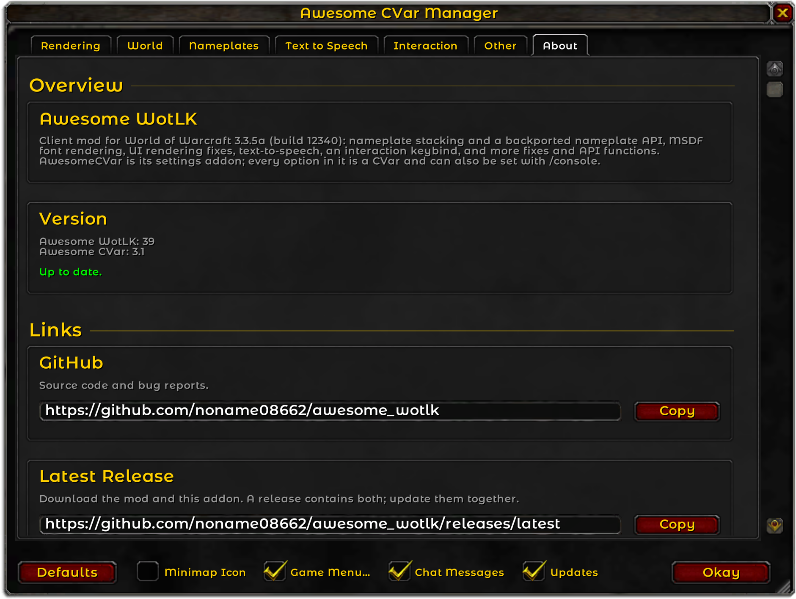

# Awesome WotLK
## World of Warcraft 3.3.5a 12340 Improvements Library
### Fork of https://github.com/FrostAtom/awesome_wotlk/

## [Details](#details) - [Installation](#installation) - [Docs](https://github.com/noname08662/awesome_wotlk/blob/main/docs/api_reference.md) - [3rd Party Libraries](#3rd-party-libraries)

___

## Details

### Features
- **MSDF Font Rendering:** Optionally enables smooth, vector-based font rendering, reducing pixelation across all in-game text. Each character is generated the first time it appears in a font, which can cause a brief stutter, and is saved to a disk cache (`Cache_AwesomeWotLK`) that is kept across game launches, so it is generated only once. Type `/msdfpregen` in-game to open a console window that generates the characters of the fonts you pick in advance. This is optional for most languages, but mandatory for Chinese and Korean clients (zhCN, zhTW, koKR): a font is rendered with MSDF only after at least its standard range (option 1) has been pre-generated; until then, it keeps the default rendering.
- **LuaJIT:** Optionally replaces the game's Lua VM with LuaJIT, so Lua code runs 2.5-3 times faster than on the stock VM (`luaSwap`, off by default, requires a client restart). While the in-game profiler (`scriptProfile`) is on, the JIT compiler doesn't run and there is no speedup, `/console scriptProfile 0`, then `/reload` turns in-game profiler off. **Risk:** this hooks the game's Lua functions, so a server whose Warden checks them could detect it. Use it at your own risk.
- **UI Rendering Fixes:** Corrects the engine's half-pixel offset, snaps UI elements to whole pixels and improves texture sampling, so thin borders and edges no longer blur or vanish when scaled down. Cooldown swipes on frames attached to nameplates, such as aura icons, no longer disappear while the nameplate moves.
- **AoE Targeting:**
  - **Projected Textures Fix:** Selection circles and AoE targeting circles are no longer cut off on slopes and hills. An AoE circle over stacked surfaces, such as a roof over the ground or a tunnel's ceiling over its floor, is drawn only on the surface under the cursor instead of on both.
  - **Ground Target Clamp:** Hovering past a ground-targeted spell's range keeps the targeting circle at the edge of that range instead of turning it into an out-of-range cursor, and a click casts there, as on retail.
- **Auto Login:** Launch with credentials via command line/shortcuts.  
  Usage: `Wow.exe -login "LOGIN" -password "PASSWORD" -realmlist "REALMLIST" -realmname "REALMNAME"`
- **Camera:** Adjust the camera's field of view, and optionally let the camera pass through trees and props, fading them out, instead of zooming in when they block the view.
- **Nameplates:**
  - **Stacking:** Nameplates stack instead of overlapping, for all, enemy or friendly plates, in a standard or a tighter "smart" layout, with adjustable spacing, reach, speeds and inertia. Addons can opt individual plates in or out.
  - **Screen Clamping:** Keeps nameplates (all or bosses only, optionally filtered by enemy/friendly) on screen at the top edge or at all edges, with adjustable margins, and can keep a clamped plate alive after its unit's model leaves the screen.
  - **Mouse Handling:** Click-through enemy or friendly plates, raising the moused-over plate above the others, resizable clickable hitboxes, and freezing the plate under the cursor in place while the others stack around it.
  - **Transparency:** Fades nameplates of units out of line of sight, and all plates except your target's, with an adjustable fade speed.
  - **Placement:** Raise or lower nameplates relative to their unit.
- **Nameplate and Tab Targeting Distance:** Nameplates can be shown up to 200 yards away, tab-targeting range can be raised up to 200 yards.
- **Voice Chat (Text-to-Speech):** Backported `C_VoiceChat` and `C_TTSSettings` text-to-speech API, using the voices installed in Windows (SAPI). Addons can read text aloud and query or select voices; speed, volume and voice are also available as CVars.
- **Smart Interaction:** A single keybind (and `/interact` macro command) that loots, skins and interacts with the nearest or forward-facing mob or object, with an optional highlight on the current target. Repeated presses cycle through nearby corpses and chests instead of reopening the same one, and skip corpses you can't skin.
- **Macro Conditionals:**
  - Backported `cursor` conditional
  - Implemented `playerlocation` conditional
- ...and other fixes, tweaks, and features.

### Addons
- **AwesomeCVar:** A settings window for all of the mod's CVars, opened with `/awesome`.
- **Flash:** Flashes the game's taskbar icon when you enter combat or receive a whisper while the game window isn't focused.

### New API Functions
- **C_NamePlate:**
  - `C_NamePlate.GetNamePlates`
  - `C_NamePlate.GetNamePlateForUnit`
  - `C_NamePlate.GetNamePlateByGUID`
  - `C_NamePlate.GetNamePlateTokenByGUID`
  - `GetStackingEnabled` nameplate method
  - `SetStackingEnabled` nameplate method
  - `GetOcclusionEnabled` nameplate method
  - `SetOcclusionEnabled` nameplate method
- **C_VoiceChat (TTS):**
  - `C_VoiceChat.SpeakText`
  - `C_VoiceChat.StopSpeakingText`
  - `C_VoiceChat.GetTtsVoices`
  - `C_VoiceChat.GetRemoteTtsVoices`
- **C_TTSSettings:**
  - `C_TTSSettings.GetSpeechRate`
  - `C_TTSSettings.GetSpeechVolume`
  - `C_TTSSettings.GetSpeechVoiceID`
  - `C_TTSSettings.GetVoiceOptionName`
  - `C_TTSSettings.SetDefaultSettings`
  - `C_TTSSettings.SetSpeechRate`
  - `C_TTSSettings.SetSpeechVolume`
  - `C_TTSSettings.SetVoiceOption`
  - `C_TTSSettings.SetVoiceOptionByName`
  - `C_TTSSettings.RefreshVoices`
- **Unit Functions:**
  - `UnitIsControlled`
  - `UnitIsDisarmed`
  - `UnitIsSilenced`
  - `UnitOccupations`
  - `UnitOwner`
  - `UnitTokenFromGUID`
- **Inventory & Items:**
  - `GetInventoryItemTransmog`
  - `GetItemInfoInstant`
- **Spell:**
  - `GetSpellBaseCooldown`
- **Miscellaneous:**
  - `FlashWindow`
  - `IsWindowFocused`
  - `FocusWindow`
  - `CopyToClipboard`
  - `QueueInteract`
  - `CaptureFrame`

### New Events
- **Nameplate Events:**
  - `NAME_PLATE_CREATED`
  - `NAME_PLATE_UNIT_ADDED`
  - `NAME_PLATE_UNIT_REMOVED`
- **TTS Events:**
  - `VOICE_CHAT_TTS_PLAYBACK_STARTED`
  - `VOICE_CHAT_TTS_PLAYBACK_FINISHED`
  - `VOICE_CHAT_TTS_PLAYBACK_FAILED`
  - `VOICE_CHAT_TTS_SPEAK_TEXT_UPDATE` _(unused)_
  - `VOICE_CHAT_TTS_VOICES_UPDATE`

### New CVars
- **Nameplate CVars:**
  - `nameplateDistance`
  - `nameplatePlacement`
  - `nameplateMouseMode`
  - `nameplateInertia`
  - `nameplateHysteresisDecay`
  - `nameplateBandX`
  - `nameplateBandY`
  - `nameplateHitboxAnchor`
  - `nameplateHitboxWidthE`
  - `nameplateHitboxHeightE`
  - `nameplateHitboxWidthF`
  - `nameplateHitboxHeightF`
  - `nameplateRaiseSpeed`
  - `nameplateLowerSpeed`
  - `nameplatePullSpeed`
  - `nameplateRaiseDistance`
  - `nameplatePullDistance`
  - `nameplateOcclusionMode`
  - `nameplateOcclusionAlpha`
  - `nameplateNonTargetAlpha`
  - `nameplateAlphaSpeed`
  - `nameplateClampMode`
  - `nameplateClampModeVOffset`
  - `nameplateClampModeHOffset`
  - `nameplateClampModeFilter`
  - `nameplateClampModeAffiliation`
  - `nameplateClampViews`
  - `nameplateMouseFreeze`
  - `nameplateMouseFreezeAffiliation`
  - `nameplateMouseFreezeGrace`
  - `nameplateMouseFreezeTime`
  - `nameplateStacking`
- **Interaction CVars:**
  - `interactionMode`
  - `interactionAngle`
  - `interactionHighlight`
- **Camera CVars:**
  - `cameraIndirectVisibility`
  - `cameraIndirectAlpha`
  - `cameraFov`
  - `showPlayer`
- **TTS CVars:**
  - `ttsVoice`
  - `ttsSpeed`
  - `ttsVolume`
- **UI CVars:**
  - `uiHalfPixelFix`
  - `uiTextureSampling`
  - `uiPixelSnap`
  - `uiCooldownSwipeFix`
- **Miscellaneous:**
  - `MSDFMode` _(requires client restart)_
  - `MSDFOutlinePass`
  - `objectHighlightMode`
  - `portraitResolution`
  - `projectedTextureMode`
  - `groundTargetClamp`
  - `tabTargetDistance`
  - `worldCullMode`
  - `luaSwap` _(requires client restart)_
  - `chatLogSessionKey`
  - `combatLogSessionKey`

### New Interaction Keybind
A new keybind for smart interaction with the game world:
- Loots mobs
- Skins mobs
- Interacts with nearby objects (ore veins, chairs, doors, mailboxes, etc.)
- Highlights the current interaction target (toggle with `interactionHighlight`)
- Can be bound under Key Bindings > Awesome Wotlk Keybinds > Interaction Button
- Can be used in macros: `/interact` or `/interact [@mouseover]` (standard Blizzard modifiers apply)

### Nameplate Stacking
New nameplate stacking system to prevent overlapping:
- Enable stacking: `/console nameplateStacking %mode%` (consult [docs](https://github.com/noname08662/awesome_wotlk/blob/main/docs/api_reference.md) for available modes)
- **Important:** If using [this WeakAura](https://wago.io/AQdGXNEBH), delete it and restart the client before using this feature
- See [Docs](https://github.com/noname08662/awesome_wotlk/blob/main/docs/api_reference.md) for detailed CVar information
- All settings are configurable in-game via `/awesome` command (requires AwesomeCVar addon)

**Recommended:** Use the AwesomeCVar addon (`/awesome`) to configure all of these CVars in-game.

### Font Blacklisting
You can exempt specific fonts from vector-based (MSDF) rendering by blacklisting them. Follow these steps:
1. Locate the target folder: Go to your game directory and find the `Fonts_AwesomeWotLK` folder. (If it does not exist, create it manually or launch the game once with MSDF enabled to have it created automatically.)
2. Exempt the font: Choose one of the following two methods:
   * Method A: Locate the `.ttf` or `.otf` file of the font you want to exclude (typically found within your `./Interface/AddOns/...` addon directories) and copy-paste it directly into the `Fonts_AwesomeWotLK` folder.
   * Method B: Create an empty file with no extension inside the `Fonts_AwesomeWotLK` folder, and name it after the font.
   
   Note for Method B: The file name must match the font's internal name (case-insensitive), not the display name shown by your addons (e.g., 'Homespun TT BRK'). You can find the internal name by double-clicking the font file to open it in Windows Font Viewer (or a similar tool) and checking the font title. To exempt only one style of a font family, name the file `Family_Style` (e.g., `Arial_Bold`).
3. Apply changes: Relaunch the game. The target font will now bypass the MSDF pipeline and render normally. Blacklisted fonts are also skipped by `/msdfpregen`.

### Font Pre-generation
With MSDF enabled, each character is generated the first time it appears in a font, which can cause a brief stutter. `/msdfpregen` generates the characters of the fonts you pick in advance and saves them to the disk cache (`Cache_AwesomeWotLK`), so they never stutter in game. This is optional for most languages, but **mandatory on Chinese and Korean clients (zhCN, zhTW, koKR)**: there, a font is rendered with MSDF only after its standard range has been pre-generated; until then, it keeps the default rendering.
1. Open the console: With `MSDFMode` enabled, log in and type `/msdfpregen`. A console window opens and lists the fonts loaded by the game and every font under `Interface\AddOns`, with how many of their characters are already cached. Fonts whose standard range is done are tagged `[COMPLETE]` (`[CJK-READY]` on Chinese and Korean clients).
2. Pick fonts: Enter a font number, several numbers and ranges (e.g., `1 3 5-7`), or `all`.
3. Pick a range:
   * Option 1: The standard range for your client's locale: U+0020-U+9FFF on zhCN/zhTW, U+0020-U+D7AF on koKR, U+0020-U+04FF on ruRU, U+0020-U+00FF on all others.
   * Option 2: A custom range, entered as start and end hex codepoints (e.g., `4E00` and `9FFF`).
4. Set a CPU limit: 1-100%, where 100 means unlimited.
5. Wait for `Generation complete.`, then relaunch the game. The standard range counts as done once at least 95% of the font's characters in it were written. Ctrl+C closes the console at any time.

### AwesomeCVar Addon

### Nameplate Features
To benefit from some of the new nameplate functionality (such as castbars on all targets or class-colored bars), you must use AwesomeWotLK-aware addons.
If you are using [ElvUI](https://github.com/ElvUI-WotLK/ElvUI) (or any of its forks), you will need [this plugin](https://github.com/noname08662/ElvUI_Extras), [this plugin](https://github.com/Zidras/ElvUI_ProjectZidras), or both to take full advantage of this mod.

___

## Installation
1. Download the latest [release](https://github.com/noname08662/awesome_wotlk/releases)
2. Extract all files to your game's root folder
3. Run `AwesomeWotlkPatch.exe` (you should see a confirmation message), or drag `Wow.exe` onto `AwesomeWotlkPatch.exe`
4. To update, download the new release and replace `AwesomeWotlkLib.dll` and the `Interface\AddOns\AwesomeCVar` folder (plus anything the release notes mention). AwesomeCVar's About tab tells you when the two don't match

___

## 3rd Party Libraries
- [MinHook](https://github.com/TsudaKageyu/minhook) - [License](https://github.com/TsudaKageyu/minhook/blob/master/LICENSE.txt)
- [asmjit](https://github.com/asmjit/asmjit) - [License](https://github.com/asmjit/asmjit/blob/master/LICENSE.md)
- [stb](https://github.com/nothings/stb) - [License](https://github.com/nothings/stb/blob/master/LICENSE)
- [bcdec](https://github.com/iOrange/bcdec) - [License](https://github.com/iOrange/bcdec/blob/main/LICENSE)
- [freetype](https://github.com/freetype/freetype) - [License](https://github.com/freetype/freetype/blob/master/docs/FTL.TXT)
- [msdfgen](https://github.com/Chlumsky/msdfgen) - [License](https://github.com/Chlumsky/msdfgen/blob/master/LICENSE.txt)
- [skia](https://github.com/google/skia) - [License](https://github.com/google/skia/blob/main/LICENSE)
- [unordered_dense](https://github.com/martinus/unordered_dense) - [License](https://github.com/martinus/unordered_dense/blob/main/LICENSE)
- [LuaJIT](https://luajit.org/) - [License](https://github.com/noname08662/awesome_wotlk/blob/main/licenses/luajit.txt)
